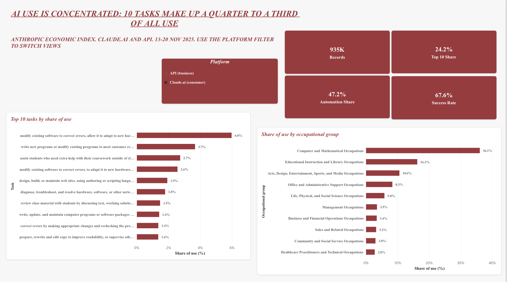

# AI Adoption and Workforce Planning

**Which roles and tasks should an organisation pick first for AI training or a workflow pilot?**
A data analysis and business analysis project on real AI usage data: about 2 million anonymised Claude conversations and API records from the [Anthropic Economic Index](https://huggingface.co/datasets/Anthropic/EconomicIndex), joined to O\*NET occupational data.

> The stakeholder (an L&D manager) is hypothetical. The data, the analysis and the numbers are real.



## The answer

Three work tasks are ready for an AI pilot, chosen from 336 eligible tasks:

| Rank | Role | Task | Success rate (95% CI) | Work use | Suggested action |
|---|---|---|---|---|---|
| 1 | Copy Writers | Edit or rewrite existing copy | 93% (92–94%) | 81% | Training |
| 2 | Interpreters and Translators | Translate legal, scientific and news texts | 87% (86–88%) | 58% | Workflow pilot |
| 5 | Correspondence Clerks | Compose replies to customer correspondence | 94% (93–95%) | 66% | Training |

All three stay in the top 6 under three different score weightings, so the choice does not depend on how the score is weighted. The recommendation, pilot design and success metrics are in [`docs/pilot_proposal.md`](docs/pilot_proposal.md).

## Key findings

1. **AI use is concentrated.** The 10 most-used tasks make up 24.2% of Claude.ai use and 32.1% of API use. Fixing software errors alone is 6.0% of Claude.ai use.
2. **Businesses automate, people collaborate.** Automation share is higher on the API in every occupational group, for example 84% vs 58% for computer occupations and 90% vs 54% for office and administrative support.
3. **More automation goes with lower success.** API success rates are lower in nearly every group (computer occupations: 38% vs 61%), even though estimated speedups are about twice as high (27× vs 13×). Fast but less reliable work needs a human review step.
4. **Office and administrative work is 1.8× more common in business use** (15.1% of API vs 8.3% of Claude.ai), pointing to back-office workflows as the main enterprise use case.
5. **Education and community/social service are mainly consumer use**: people learning with AI rather than businesses deploying it.

## Validation: 12 of 12 checks pass

Every dashboard number comes from a saved SQL query, and the pipeline reproduces Anthropic's published figures ([`sql/q9_reconciliation_checks.sql`](sql/q9_reconciliation_checks.sql)):

| Check | This project | Anthropic report |
|---|---|---|
| Top-10 task share, Claude.ai | 24.2% | 24% |
| Top-10 task share, API | 32.1% | 32% |
| Computer and Mathematical share, Claude.ai | 36.1% | 36% |
| Computer and Mathematical share, API | 51.8% | 52% |
| Overall success rate, Claude.ai | 67.6% | 67% |
| Overall success rate, API | 47.9% | 49% |

Internal checks cover usage shares summing to 100%, the occupation split keeping all 1,792,680 records, and the pilot list having no duplicates or rule-breaking rows.

## How DA and BA connect

```
Business brief → Python preparation → SQL analysis → Power BI dashboard → Pilot proposal
 (BA: need)        (DA: clean data)    (DA: evidence)  (DA + BA: decision)   (BA: action)
```

| BA artefact | File |
|---|---|
| Business brief: stakeholder, decision, questions, scope | [`docs/01_business_brief.md`](docs/01_business_brief.md) |
| Stakeholders, MoSCoW requirements, user stories, KPI definitions, assumptions log, traceability | [`docs/requirements.xlsx`](docs/requirements.xlsx) |
| AS-IS / TO-BE process map for the correspondence pilot | [`docs/process_map.png`](docs/process_map.png) |
| Pilot proposal with success metrics and risks | [`docs/pilot_proposal.md`](docs/pilot_proposal.md) |

Each requirement traces to a SQL query, a dashboard page and an acceptance check.

## Dashboard (Power BI, 4 pages)

| Page | Question answered |
|---|---|
| [AI usage overview](dashboard/01_ai_usage_overview.png) | Where is AI used? |
| [Roles and tasks](dashboard/02_roles_and_tasks.png) | Which roles use it, and how do consumer and business use differ? |
| [Pilot opportunities](dashboard/03_pilot_opportunities.png) | Which three tasks should we pilot, and with what cautions? |
| [Data quality](dashboard/04_data_quality.png) | Can the numbers be trusted? |

The model is a star schema (one fact table, occupation and platform dimensions), with weighted DAX measures for usage share, success rate, automation share and speedup.

## Method

1. **Import** the four files with every column read as text, so occupation codes are never converted to dates (`src/02_import.py`).
2. **Reshape** Anthropic's long format (one row per number) into one row per platform × task, with usage, success, collaboration, use case and time metrics (`src/05_prepare_tasks.py`).
3. **Join** tasks to occupations by normalised task text (100% match), split usage equally when a task belongs to several occupations, and attach occupational groups (`src/06_join_occupations.py`).
4. **Analyse** in DuckDB SQL: rankings, platform comparison, pilot score with Wilson confidence intervals, and reconciliation checks (`sql/`).
5. **Export** the results to one Excel model for Power BI (`src/08_export_powerbi.py`).

**Pilot score** = 0.5 × percentile rank of usage + 0.5 × percentile rank of success rate, among Core tasks with at least 100 conversations, at least 100 assessed for success, and at least 50% work use. A task becomes a *workflow pilot* when businesses already automate it via the API (at least 80% on at least 100 records); otherwise it is a *training* candidate.

## Data problems found and fixed

- **Time units:** human-only time is in hours but human-with-AI time is in minutes. Dividing them directly gave speedups below 1; converting hours to minutes fixed it, and the corrected figures match Anthropic's.
- **Mixed occupation codes:** the O\*NET task file mixes SOC 2010 and SOC 2019 codes. Major groups are derived from the code prefix, which is valid in both versions, so every row gets a group.
- **Placeholder tasks:** "none" and "not_classified" (6.5% of Claude.ai and 11.7% of API records) count in totals but are never ranked.
- **Excel date damage:** codes like 11-2021 turn into "Nov-21" if a CSV is opened and saved in Excel. The import script checks for this.

## Limitations

- One week of data (13–20 Nov 2025): no trends over time.
- Success, collaboration and time are Claude's own assessments of anonymised conversations, not verified outcomes.
- Users bring tasks they expect AI to handle, so success rates may be higher than real-world performance.
- Small groups are removed for privacy before release.
- Occupations use US definitions (O\*NET, SOC); results are indicative for other labour markets.
- Minor occupational groups exist only for SOC 2019 codes (60% of Claude.ai usage), so the dashboard filters by major group.

## Run it yourself

```bash
python -m venv .venv && source .venv/bin/activate
pip install -r requirements.txt

python src/01_download.py          # download the 4 raw files from Hugging Face
python src/02_import.py            # load and check
python src/05_prepare_tasks.py     # task table
python src/06_join_occupations.py  # join to occupations
python src/07_run_sql.py           # run all SQL queries and checks
python src/08_export_powerbi.py    # build the Power BI model file
```

`src/03_profile.py` and `src/04_inspect_tasks.py` are the exploration steps used to understand the data's structure.

## Repository structure

```
├── dashboard/   Power BI screenshots
├── data/
│   ├── raw/        downloaded files (not committed)
│   ├── processed/  clean tables from Python (regenerated)
│   └── outputs/    SQL results and the Power BI model file
├── docs/        business brief, requirements workbook, process map, pilot proposal
├── notebooks/   exploration
├── sql/         analysis queries and reconciliation checks
└── src/         Python pipeline
```

## Tools

Python (pandas) · SQL (DuckDB) · Power BI (DAX, star schema) · Excel · draw.io · Git

## Data sources and licence

- [Anthropic Economic Index](https://huggingface.co/datasets/Anthropic/EconomicIndex): Claude.ai and 1P API data, 13–20 November 2025 (CC-BY 4.0). Report: [Economic primitives, January 2026](https://www.anthropic.com/research/anthropic-economic-index-january-2026-report).
- O\*NET task statements and the SOC 2019 structure, as packaged in the same repository.

## Use of AI

Claude helped plan the project and draft code and documents. I ran every step, checked each result against the source data and Anthropic's published figures, and found and fixed the issues listed above.
